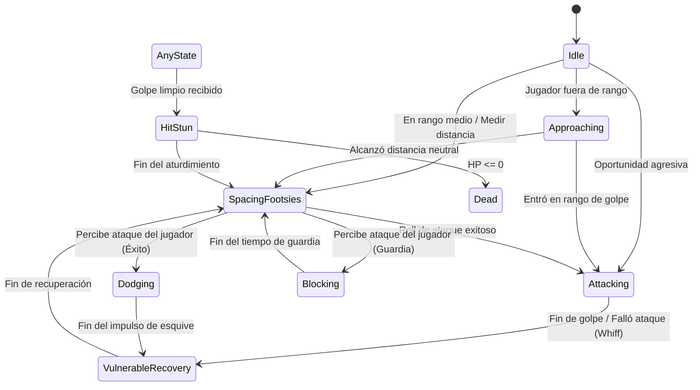

# 🥊 Minijuego de Pelea: Sistema Completo de IA para Bot (FighterBotAI)

Este módulo contiene la implementación completa en **C# para Unity** de una Inteligencia Artificial para bots de combate cuerpo a cuerpo / lucha.

El diseño está calibrado para una **Dificultad Intermedia Justa**: el bot ofrece un desafío emocionante, se mueve de forma orgánica, contraataca y esquiva, pero **no hace trampa leyendo inputs instantáneamente**, dejando ventanas claras de castigo para que el jugador pueda ganar mediante habilidad táctica.

---

## 📁 Archivos Creados en `Unity_Minijuego_Pelea/`

| Archivo | Rol en el Sistema |
|---|---|
| [`FighterBotAI.cs`](./FighterBotAI.cs) | **Núcleo de la IA**: Máquina de Estados FSM, espaciado táctico (*Footsies*), combos, esquive reactivo humano, ventanas de vulnerabilidad y soporte 3D/2D. |
| [`FighterHitbox.cs`](./FighterHitbox.cs) | Componente de impacto para puños, patadas o armas. Detecta impactos y alerta al bot con radio de percepción. |
| [`PlayerFighterCombat.cs`](./PlayerFighterCombat.cs) | Controlador jugable con WASD, golpes ligeros/fuertes, guardia y esquive para probar el duelo inmediatamente. |
| [`FighterCombatHUD.cs`](./FighterCombatHUD.cs) | HUD inmediato en pantalla (`OnGUI`) con barras de vida de ambos luchadores y estado táctico de la IA en vivo. |

---

## 🧠 Arquitectura de la IA y Dificultad Intermedia

### 1. ¿Por qué la mayoría de IAs de pelea se sienten injustas o aburridas?
* **Bots Imposibles:** Leen los botones del jugador en el frame 0 y esquivan/bloquean el 100% de los golpes.
* **Bots Demasiado Fáciles:** Se quedan quietos o avanzan en línea recta absorbiendo golpes como sacos de boxeo.

### 2. La Fórmula de la Dificultad Intermedia Implementada:
1. **Tiempo de Reacción Humano Simulado (`reactionDelayMin` / `reactionDelayMax`):**
   - Cuando el jugador lanza un golpe, el bot **tarda entre 200 ms y 350 ms** en procesarlo mentalmente. Esto da tiempo al jugador para conectar ataques sorpresivos o rápidos.
2. **Margen de Error Humano (`dodgeProbability: 60%`):**
   - El bot tiene un 60% de éxito al esquivar y un 40% de fallo donde calcula mal o queda expuesto, recompensando al jugador constante.
3. **Enfriamiento de Esquive (`dodgeCooldown: 2.2s`):**
   - Tras realizar un *Dash/Roll*, el bot no puede volver a esquivar de inmediato. Si el jugador hace un amague (*feint*) y el bot gasta su esquive, el jugador puede perseguirlo y conectar un combo completo.
4. **Ventana de Castigo por Fallo (*Whiff Punish* - `whiffRecoveryDuration: 0.6s`):**
   - Cuando el bot ejecuta un golpe pesado y falla (porque el jugador se alejó o esquivó), entra en el estado `VulnerableRecovery`. En este estado **no puede bloquear ni atacar**, dando al jugador una ventana de oro para castigarlo.
5. **Juego Neutral y Espaciado (*Footsies*):**
   - El bot no camina en línea recta hacia ti todo el tiempo. Mantiene una distancia óptima (`optimalSpacingDistance`), da pasos laterales (flanqueo), amaga hacia adelante y retrocede si te acercas demasiado.

---

## 🔄 Máquina de Estados Finita (FSM)

---

## ⚙️ Tabla de Calibración de Dificultad

Puedes cambiar el comportamiento del bot en el Inspector modificando estos parámetros:

| Parámetro | Principiante (Fácil) | **Intermedio (Recomendado)** | Maestro (Difícil) |
|---|---|---|---|
| **`reactionDelayMin - Max`** | `0.40s - 0.60s` | **`0.20s - 0.35s`** | `0.08s - 0.15s` |
| **`dodgeProbability`** | `25%` | **`60%`** | `85%` |
| **`blockProbability`** | `30%` | **`50%`** | `80%` |
| **`dodgeCooldown`** | `3.5s` | **`2.2s`** | `1.0s` |
| **`whiffRecoveryDuration`** | `0.90s` (Muy vulnerable) | **`0.60s`** (Justo) | `0.25s` (Casi no castigable) |
| **`aggressionRate`** | `0.35` (Pasivo) | **`0.60`** (Balanceado) | `0.85` (Implacable) |

---

## 🛠️ Guía Rápida de Integración en Unity

### Paso 1: Configurar el GameObject del Bot
1. En tu escena de Unity, crea un objeto 3D o 2D (por ejemplo, un Capsule, Modelo 3D o Sprite del enemigo).
2. Asígnale el tag **`Enemy`**.
3. Asegúrate de que tenga un `Collider` (o `CapsuleCollider`) y opcionalmente un `CharacterController` o `Rigidbody`.
4. Agrégale el componente **`FighterBotAI`**.
5. Selecciona el **`Dimension Mode`**:
   - `ThreeD_Arena_XZ` para juegos 3D (Tekken, Sifu).
   - `TwoD_SideScroller_XY` para juegos 2D / 2.5D (Street Fighter, Smash).
   - `TwoD_TopDown_XY` para juegos 2D con vista cenital.

### Paso 2: Configurar Hitboxes (Puños / Patadas)
1. En los huesos o hijos del personaje (ej: `RightHand`, `RightFoot`), crea un GameObject hijo con un Collider en modo **`Is Trigger = true`**.
2. Agrégale el componente **`FighterHitbox`**.
3. Configura:
   - `Damage`: 15
   - `Owner Tag`: `Enemy` (para el bot) o `Player` (para el jugador).
   - `Target Tag`: `Player` (para el bot) o `Enemy` (para el jugador).
4. El script `FighterHitbox` se activa y desactiva mediante `EnableHitbox()` y `DisableHitbox()` (ideal para **Animation Events** o timers).

### Paso 3: Sincronización con el Animator (Opcional)
Si tu personaje tiene animaciones, `FighterBotAI` envía automáticamente los siguientes parámetros al `Animator`:

| Parámetro en Animator | Tipo | Descripción |
|---|---|---|
| `Speed` | `Float` | `0.0` (quieto), `0.5` (footsies/caminata), `1.0` (carrera/acercarse) |
| `State` | `Integer` | Índice de estado según el enum `BotCombatState` (0 a 8) |
| `LightAttack` | `Trigger` | Dispara el ataque ligero rápido |
| `HeavyAttack` | `Trigger` | Dispara el ataque fuerte con anticipación |
| `Dodge` | `Trigger` | Dispara la animación de rodar o dar un paso evasivo |
| `IsBlocking` | `Bool` | `true` mientras el bot mantiene la postura defensiva |
| `Hit` | `Trigger` | Dispara la reacción de impacto (HitStun) |
| `Die` | `Trigger` | Dispara la animación de derrota |

### Paso 4: Probar el Combate en 1 Clic
1. A tu personaje jugador agrégale el script `PlayerFighterCombat`.
2. En cualquier GameObject vacío de la escena, agrega `FighterCombatHUD`.
3. Dale **Play** en Unity:
   - Muévete con **WASD**.
   - Golpea con **J** (rápido) o **K** (pesado).
   - Esquiva con **L** o **Shift**.
   - Cubre con **I** o **Espacio**.
   - Observa en el HUD superior cómo la IA evalúa la distancia, cambia de estado en tiempo real y reacciona de forma intermedia.

